<!-- Generated by scripts/build.py. Edit the script, not this file. -->

<picture><source media="(prefers-color-scheme: dark)" srcset="assets/header-dark.svg"></picture>

 

   

 

<picture><source media="(prefers-color-scheme: dark)" srcset="assets/section-impact-dark.svg"></picture>

<picture><source media="(prefers-color-scheme: dark)" srcset="assets/kpis-dark.svg"></picture>

I'm a **Business Analyst for MES and ERP** who has worked on every side of manufacturing: refinery internships, a specialty-chemicals plant, my own tofu factory and now a steel MES. I write the requirements and business rules that turn plant processes into working systems, and I check my work in the browser with Playwright before it reaches UAT.

 

<picture><source media="(prefers-color-scheme: dark)" srcset="assets/section-career-dark.svg"></picture>

<picture><source media="(prefers-color-scheme: dark)" srcset="assets/career-dark.svg"></picture>

 

<picture><source media="(prefers-color-scheme: dark)" srcset="assets/section-process-dark.svg"></picture>

<picture><source media="(prefers-color-scheme: dark)" srcset="assets/process-dark.svg"></picture>

 

<picture><source media="(prefers-color-scheme: dark)" srcset="assets/section-projects-dark.svg"></picture>

<a href="https://mock-test-generater-new.vercel.app"><picture><source media="(prefers-color-scheme: dark)" srcset="assets/project-nursai-dark.svg"></picture></a>
<a href="https://subscription-auditor-india.streamlit.app"><picture><source media="(prefers-color-scheme: dark)" srcset="assets/project-subs-dark.svg"></picture></a>
 
<a href="https://link-in-bio-27p.pages.dev"><picture><source media="(prefers-color-scheme: dark)" srcset="assets/project-linkbio-dark.svg"></picture></a>
<a href="https://swapnil-dhavate.github.io/public-ship-log/"><picture><source media="(prefers-color-scheme: dark)" srcset="assets/project-shiplog-dark.svg"></picture></a>
 
<a href="https://swapnil-dhavate.netlify.app/#work"><picture><source media="(prefers-color-scheme: dark)" srcset="assets/project-chief-dark.svg"></picture></a>
<a href="https://swapnil-dhavate.netlify.app/#work"><picture><source media="(prefers-color-scheme: dark)" srcset="assets/project-jobs-dark.svg"></picture></a>
 
<a href="https://swapnil-dhavate.netlify.app/#work"><picture><source media="(prefers-color-scheme: dark)" srcset="assets/project-pulse-dark.svg"></picture></a>
<a href="https://swapnil-dhavate.netlify.app/#work"><picture><source media="(prefers-color-scheme: dark)" srcset="assets/project-shorts-dark.svg"></picture></a>
 
<a href="https://swapnil-dhavate.netlify.app/#work"><picture><source media="(prefers-color-scheme: dark)" srcset="assets/project-voice-dark.svg"></picture></a>
<a href="https://swapnil-dhavate.netlify.app/#work"><picture><source media="(prefers-color-scheme: dark)" srcset="assets/project-money-dark.svg"></picture></a>
 
<a href="https://swapnil-dhavate.netlify.app/#work"><picture><source media="(prefers-color-scheme: dark)" srcset="assets/project-security-dark.svg"></picture></a>
<a href="https://swapnil-dhavate.netlify.app/#work"><picture><source media="(prefers-color-scheme: dark)" srcset="assets/project-smarthome-dark.svg"></picture></a>

> [!NOTE]
> I write the spec, Claude Code writes the code, and I test it until it works. Source code stays private, so this page is the showcase. Live demos are linked, and I'm happy to walk through any project in an interview.

<b>Plain-text project list</b>

| Project | What it does | Built with | Link |
|---|---|---|---|
| **NursAI Prep** | Timed mock tests with negative marking for nursing exams (DHS/DMER, NCLEX), study tracking and an admin question bank. | React, TypeScript, Supabase, Gemini | [Open](https://mock-test-generater-new.vercel.app) |
| **Subscription Auditor** | Finds forgotten subscriptions in Indian bank statements with testable rules, so no bank data ever goes to AI. | Python, pandas, Streamlit | [Open](https://subscription-auditor-india.streamlit.app) |
| **Link-in-Bio Page** | Self-hosted Linktree alternative with first-party click analytics and AI-written weekly insights. | Cloudflare Pages, D1, Chart.js | [Open](https://link-in-bio-27p.pages.dev) |
| **Public Ship Log** | Build-streak tracker: logs work from Telegram and GitHub commits, drafts Bluesky posts for approval, publishes a heatmap. | Python, GitHub Actions, Pages | [Open](https://swapnil-dhavate.github.io/public-ship-log/) |
| **AI Chief of Staff** | One morning brief on Telegram from Gmail, Calendar, Tasks, Drive and Outlook. Saves drafts, never sends email. | Apps Script, Gemini, Power Automate | Demo on request |
| **Job Alerts + Cover Letters** | BA openings from 5 job boards and about 66 career portals, de-duplicated, with tailored cover letters on demand. | Cloudflare Workers, KV, Actions | Demo on request |
| **AI Pulse Engine** | Daily LinkedIn post drafts with branded AI image cards, sent to Telegram for a YES/NO approval before posting. | Gemini, Workers, FLUX | Demo on request |
| **YouTube Shorts Pipeline** | Daily Hindi-narrated Shorts: AI script, TTS voice, AI images and ffmpeg editing, approved by a human first. | Gemini, Piper TTS, ffmpeg | Demo on request |
| **Voice Note Idea Catcher** | Voice notes from walks become sorted idea lists, with duplicate detection and a weekly digest. | Whisper, Gemini, SQLite | Demo on request |
| **Money Dashboard** | Income dashboard with AI categorisation. Every total is calculated in code, never by the AI. | Python, SQLite, Chart.js | Demo on request |
| **Security Checker** | Finds exposed API keys in code and git history before deploy, with masked reports and CI blocking. | gitleaks, Python, pre-commit | Demo on request |
| **Smart Home Agent** | Controls a Samsung TV from Telegram, voice or the command line through an AI agent. | Workers, SmartThings, Claude | Demo on request |

 

<picture><source media="(prefers-color-scheme: dark)" srcset="assets/section-activity-dark.svg"></picture>

<picture><source media="(prefers-color-scheme: dark)" srcset="assets/activity-dark.svg"></picture>

 

<picture><source media="(prefers-color-scheme: dark)" srcset="assets/section-toolbox-dark.svg"></picture>

<picture><source media="(prefers-color-scheme: dark)" srcset="assets/toolbox-dark.svg"></picture>

 

<picture><source media="(prefers-color-scheme: dark)" srcset="assets/footer-dark.svg"></picture>

**Hiring a BA who has run the plant?** [Let's talk →](https://swapnil-dhavate.netlify.app/#contact)

